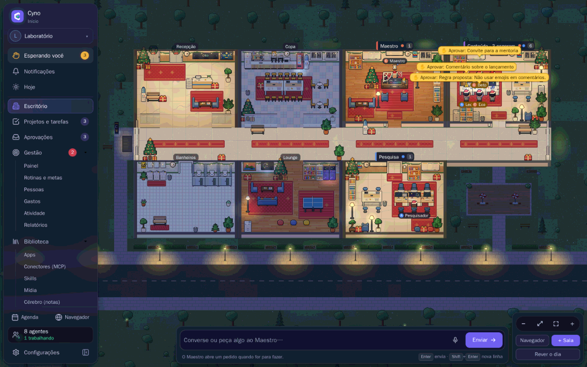
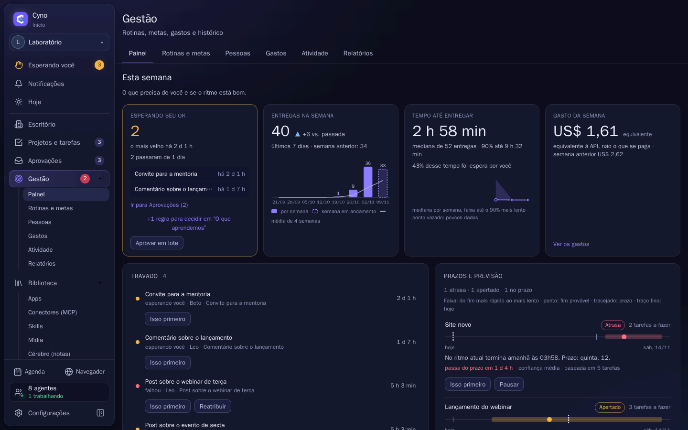
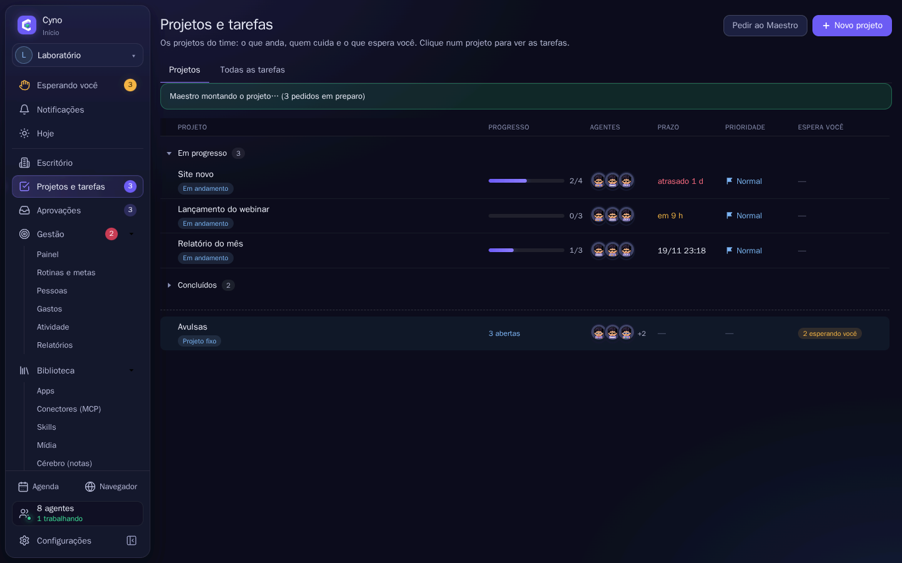

# Cyno

[](https://github.com/harryChrist/cyno-office/actions/workflows/ci.yml)

Um escritório de agentes de IA: cada agente é uma CLI de assinatura (Claude Code, Antigravity e outras) rodando como terminal de fundo, e você acompanha e comanda tudo por um app web com um mapa em pixel art.



## O que tem

- **Escritório vivo:** um mapa em pixel art com as salas do workspace, os agentes andando, sentando para trabalhar e pedindo aprovação, mais a cidade onde ficam os outros workspaces.
- **Maestro:** em cada workspace, um agente que recebe seus pedidos, monta projetos e tarefas e distribui para os times.
- **Projetos, sprints e tarefas:** lista e quadro, prazos, ritmo, dependências entre tarefas e um agendador que escolhe o próximo trabalho sem gastar IA.
- **Para você (Aprovações):** tudo que precisa do seu OK, com o texto editável antes de sair.
- **Rotinas e Calendário:** trabalhos recorrentes e a agenda do workspace.
- **Cérebro:** notas em Markdown por sala e globais, que os agentes leem e escrevem.
- **Biblioteca:** apps, conectores (MCP), skills e mídia.
- **Gestão:** painel da semana, pessoas, previsões de prazo, relatórios, atividade e metas.
- **Gastos:** consumo por agente e por workspace (equivalente à API, não o que se paga na assinatura).
- **Cada agente é um terminal observável:** abra qualquer um e veja o trabalho ao vivo.
- **Acesso por senha** opcional, e workspaces totalmente isolados entre si.

<p>
  
  
</p>

Os prints usam dados fabricados do ambiente de laboratório (`npm run lab:up`).

## Como funciona

- **Agentes reais, sem API paga.** Cada agente roda numa CLI de assinatura (Claude Code, Antigravity; há adaptadores para outros motores) como processo de fundo. O app não usa chave de API: ele limpa do ambiente de cada processo as variáveis de provedores e para o terminal se a CLI tentar usar uma.
- **MCP próprio.** Os agentes falam com o app por um servidor MCP do Cyno: pegam tarefas, entregam resultados, pedem aprovação, leem e gravam notas no Cérebro.
- **Maestro.** Você pede algo ao Maestro; ele cria o projeto, divide em tarefas, escolhe o time e revisa o que volta.
- **Workspaces.** O nível mais alto (por exemplo "LinkedIn", "Instagram"). Cada um tem escritório, projetos, Cérebros, fila e Maestro próprios, sem nada em comum com os outros.
- **Dados em arquivos JSON** (`data/`, fora do git), com escrita atômica. Não há banco de dados.

O modo simulado (`AGENT_RUNNER=mock`) existe só para os testes automáticos.

## Requisitos

- Node 22.12 ou mais novo e npm (o Vite 8 e o Vitest 5 não funcionam no Node 20).
- Pelo menos uma CLI de agente instalada e logada na sua assinatura (por exemplo `claude`) para ter agentes de verdade. Sem ela o app abre, mas os agentes não trabalham.
- Para os testes e2e: `npx playwright install chromium`.

## Como rodar

Três caminhos (detalhes em [docs/como-rodar.md](docs/como-rodar.md)). Em todos, a UI fica em `http://localhost:3067` (ou `http://<ip-do-servidor>:3067` na rede local) e na primeira subida o server cria o workspace de exemplo.

**Desenvolvimento** (Node >= 22.12):

```bash
npm install
npm run dev
```

**No Windows:** use o Docker (abaixo) ou rode tudo de dentro do Ubuntu no WSL2. O `npm run dev` e o pm2 direto no Windows não funcionam.

**Em segundo plano com pm2** (`npm i -g pm2`; só Linux e macOS):

```bash
npm install
npm run pm2:start        # sobe maestri-server e maestri-web (compila a web)
npm run pm2:logs         # logs; pm2:restart e pm2:stop também existem
```

**Docker** (Docker com Compose v2):

```bash
docker compose up -d --build
docker compose exec cyno claude     # login da sua assinatura do Claude Code (fica salvo no volume)
```

| Script | O que faz |
|---|---|
| `npm run dev` | server (`tsx watch`, porta 3068, só loopback) e web (Vite, porta 3067) juntos |
| `npm start` | build do web e execução sem watch |
| `npm run build` | build de todos os pacotes |
| `npm run typecheck` | `tsc` em todos os pacotes e na raiz |
| `npm run lint` | ESLint, sem avisos permitidos |
| `npm test` | Vitest (unitários e integração) |
| `npm run test:e2e` | Playwright, com `DATA_DIR` temporário e portas próprias |
| `npm run lab:up` | app de teste isolado (portas 3101 e 5273, dados temporários, `CYNO_AUTH=off`: aberto); `LAB_HISTORY_DAYS=21` semeia histórico fabricado |
| `npm run seed` | recria `data/` com o workspace inicial (apaga o que existe) |

Seguro desde a instalação: sem senha o app fica fechado e o servidor escreve no log um código para criar a senha na primeira visita (bloqueio por IP e verificação em duas etapas opcional incluídos; veja "Primeiro acesso" em [docs/como-rodar.md](docs/como-rodar.md)). O ditado por voz exige HTTPS ou `localhost` (`WEB_HTTPS=1 npm run dev`). Variáveis, agentes reais, laboratório, pm2, Docker e rede: [docs/como-rodar.md](docs/como-rodar.md).

## Estrutura

```
packages/
  shared/   tipos, schemas zod, eventos WebSocket e regras compartilhadas
  server/   Fastify 5 + WebSocket: workspaces, Maestro, projetos, MCP, motores dos agentes
  web/      Vite + React 19 + Zustand: a interface e o adaptador do mapa
  cena/     motor de cena em pixel art (Canvas 2D), derivado de um projeto MIT
  site/     site de apresentação (uma página estática, Vite; hospedável na Vercel: veja packages/site/README.md)
e2e/        testes Playwright, incluindo acessibilidade (axe)
scripts/    utilitários (lab-up.mjs: app de teste isolado)
docs/       documentação
data/       estado de runtime (não versionado)
```

## Documentação

- [Usando o escritório](docs/usando-o-escritorio.md): a interface, tela por tela.
- [Conectar o Gmail](docs/conectar-o-gmail.md): o passo a passo do Google Cloud ao agente lendo e-mails.
- [Como rodar](docs/como-rodar.md): requisitos, variáveis, agentes reais, laboratório e acesso pela rede.
- [Arquitetura](docs/arquitetura.md): servidor, dados, MCP, motores, cena e decisões de cada área.
- [Criando agentes e workspaces](docs/como-criar-agentes-e-workspaces.md)
- [Decisões, limitações e referências](docs/decisoes-e-limitacoes.md): senha, desempenho, decisões do início do projeto e limitações conhecidas.
- [Site de apresentação](packages/site/README.md): o código do site e como publicá-lo na Vercel.
- [CHANGELOG](CHANGELOG.md): o histórico de mudanças.

## Contribuindo

Contribuições são bem-vindas. Os PRs apontam para a branch `dev`; o passo a passo, o fluxo de branches e as convenções estão em [CONTRIBUTING.md](CONTRIBUTING.md). Vulnerabilidades: [SECURITY.md](SECURITY.md).

## Créditos e licenças

O Cyno é distribuído sob a licença MIT: veja [LICENSE](LICENSE).

O motor de cena e a arte do mapa vêm do projeto de código aberto Habblaud, de Márcio Junior, sob licença MIT (copiados e adaptados em `packages/cena/`; origem em [`packages/cena/ORIGEM.md`](packages/cena/ORIGEM.md)). Os avisos de licença de todos os componentes de terceiros, incluindo os ícones dos conectores (CC0), estão em [`THIRD_PARTY/`](THIRD_PARTY/README.md).
